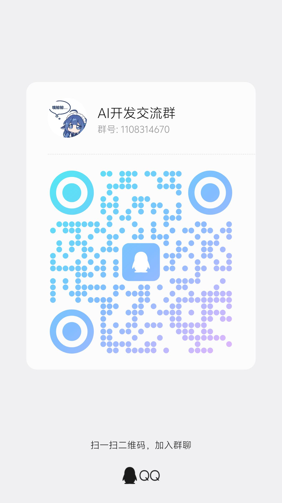

# Link Mesh

**手机之间、手机和电脑之间，不碰云端的文件互传。**

同一 Wi-Fi 下自动发现对方，直接传文本和文件；电脑打开一个网页就能收发；跨网络时用 P2P 打洞直连。

> Android 4.4+ ｜ 免费开源 ｜ 无需注册 ｜ 无广告 ｜ 无遥测 ｜ 数据不出局域网

---

## 为什么会有这个

微信传文件：压缩画质、限制大小、还得登电脑版。
网盘：先上传到云、再让对方下载——**一个文件走了两遍流量，还在别人服务器上过了一夜**。
快传类 App：要么塞满广告，要么逼你注册账号。

想要的其实特别简单：**两台设备在同一个房间里，文件应该直接从一台飞到另一台。**

Link Mesh 就是干这个的。整个过程不经过任何服务器——不是"我们承诺不上传"，是**架构上就没有上传这条路**。

---

## 功能

### 局域网直连（主场景）

- 打开就自动发现附近设备（NSD + 组播双通道，5 秒内互相出现）
- 互发文本和文件，**128KB 分块 + 断点续传 + SHA-256 校验**——传一半断网，重连接着传
- 大文件实测：**1GB 传输内存占用恒定**，切后台 30 秒回来接着传
- 首次连接弹确认卡片，拒绝后对方不再打扰——**信任关系只存在两台设备上**

### 网页端（电脑免装）

- 手机上点一下，电脑浏览器打开 `http://手机IP:端口`
- 聊天界面，和 App 内体验一致；发文本、传文件（带进度条）、下载文件
- 每个浏览器独立身份，消息分开展示
- **右上角一键下载 App**——传给没装的朋友，装完就能用

### P2P 跨网直连（Android 5.0+）

- WebRTC DataChannel，信令做成**二维码**，扫一下就建立连接
- 只用公共 STUN，**不配 TURN**（不租服务器，零成本）
- 打洞失败 60 秒内明确提示，并引导改用局域网或网页中转，不会无限转圈
- 支持 IPv6 直连（绕过 NAT 的最便宜方案）

### 细节

- 深色 / 浅色 / 跟随系统，切换带过渡动画
- 底部导航可拖拽排序、隐藏页面、设默认主页
- 接收文件存到**你选的公共文件夹**（SAF 授权），文件管理器直接看
- 传输完成 / 收到消息：强提醒（震动 + 通知）
- 可关的自动接收：关掉后每个文件都要你点头
- Android 4.4 都能装能跑——老设备救星

---

## 下载

| 渠道 | 说明 |
|---|---|
| GitHub Releases | 下载 `LinkMesh.apk`，直接安装 |
| 网页端互传 | 已安装的设备在网页上点「下载 App」 |

> 应用内也可以直接把安装包发给对方（聊天页 `+` → 发送本应用安装包）。

---

## 技术上值得一提的

- **minSdk 19**：NsdServiceInfo 不带 attributes、通知小图标单色化、`getHostAddresses()` 返回类型在 API 34 变更……一批 API 19 兼容坑都踩过并记录在代码注释里
- **手写 HTTP 服务**：没有引 OkHttp/NanoHTTPD，5 个路由 + 流式上传，APK 体积可控
- **UPnP / NAT-PMP 自动端口映射**：尝试穿透家用路由器（双重 NAT 下只能穿一层，这是机制不是 bug）
- 完整的架构说明、协议设计和踩坑记录见 **[DEVELOP.md](DEVELOP.md)**

---

## 常见问题

**Q：我的文件会被上传到哪里？**
哪里都不去。传输是设备到设备的直连，App 里没有任何上传代码。

**Q：和 XX 快传比有什么区别？**
无广告、无账号、无云。老安卓（4.4）也能用。开源可查证。

**Q：P2P 连不上？**
双方都在对称型 NAT 后面时打洞会失败（物理限制，无 TURN 就无解）。改用局域网直连，或让一端开网页端中转。

**Q：电脑怎么用？**
不用装任何东西，浏览器打开手机上显示的地址。

---

## 反馈与联系

遇到问题、有想法，都欢迎找我。下面几个渠道我手机上都有推送：

| QQ 群 ⭐ | 酷安 | 爱发电 |
|:---:|:---:|:---:|
|  |  |  |
| **AI开发交流群** 群号 `1108314670` | 扫一扫，来酷安找我 | 请我喝杯咖啡 |

- 💬 **QQ 群** —— 有问题直接在群里问，**推荐优先用这个**：发截图方便，也能看到别人踩过的坑
- 🖼 **酷安** —— 适合贴截图、聊得长一点的讨论
- 🐛 **GitHub [Issue](https://github.com/hesanyue50-lang/link-mesh/issues)** —— 正式的 bug 和功能需求建议开一条：能留档，别人也搜得到
- ☕️ **爱发电** —— 定制需求私信，或者单纯请我喝杯咖啡

### ⏱ 响应节奏

这是个**个人项目**，不是客服团队，先把预期说清楚：

| | 大概需要 |
|---|---|
| 消息回复 | **两天左右** |
| 从定位问题到修好、发新版本 | **一到两周** |

更新是按节奏批量发布的，不会发现一个 bug 就立刻推一版。急事请在消息里直接说明。

---

## 定制 / 商业授权

这个项目是**免费开源**的，自己用、改、发给朋友都随意。

常见的定制需求：**换皮白标（改成你自己团队的名字和图标）、加传输加密、接自家设备的发现协议、定制接收流程**。谈好报价和工期再开工，不需要先付全款。

**商业授权**：本项目以 AGPL-3.0 授权。如果你需要在自己的产品里闭源使用，可以单独商谈商业授权。

---

## 许可证

**GNU Affero General Public License v3.0**，全文见 [LICENSE](LICENSE)。

简单说：

- ✅ 自己使用、修改、再分发，都不受限制
- ⚠️ **如果你分发修改后的版本，或者把它做成网络服务提供给他人，必须同样开源**
- ⚠️ 闭源使用需要单独获得商业授权

> 这条只针对"拿去给别人用"的场景。**个人自己装自己用，不触发任何义务。**

---

## 开发

构建链、架构说明、实现细节和踩过的坑，全部记在 **[DEVELOP.md](DEVELOP.md)**。
